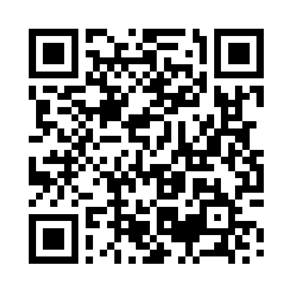

# 山探し

目の前に広がる景色から、お題の山を探してタップするWebゲームです。
国土地理院の標高タイル・空中写真と、国土地理院「日本の主な山岳標高」（約1,000座、百名山・二百名山・三百名山の区分つき）や高さ100m以上の主な構造物のデータから、
その地点から実際に見える山の景色をブラウザ上で再現します。

## 遊び方

1. **現在地でスタート** を押すと、現在地（GPS）から見える景色が表示されます。
   スタートを押した瞬間に端末が向いている方角から始まります（コンパス非対応の端末では北向き）。
   **地点を選んでスタート** では地図や山の名前から好きな地点（山頂など）を選べます。
2. 「**富士山を探して！**」のようにお題が出るので、景色の中からその山を探してタップ。正解なら得点です。
   違う山をタップすると「そこは○○です」と教えてくれます。
3. 操作
   - 2本指ドラッグ：方角・上下の角度を変える（1本指・マウスのドラッグでも可）
   - ピンチ／マウスホイール：ズーム
   - 右側の ▲▼：その場で視点の高さを上下（地上1.6m〜5000m）
   - 右上：コンパス（向いている方角と視野）
   - ⏸：一時停止／ヒント：方角と距離を表示／パス：答えを見て次へ／山名：見えている山の名前を表示
   - 🧭 追従：オンにすると、スマホを向けた方角に景色が合わせて動く（左右にドラッグするとオフ）

## 仕組み

- `src/worker.js`（Web Worker）
  - 地理院 標高タイル（`dem_png`）を z14（〜2.5km）・z12（〜10km）・z10（〜80km）・z8（〜300km）の4段階で読み込みます。
    近いほど高解像度のタイルを使います。
    取得できないタイルは AWS Terrain Tiles（terrarium）を代わりに使います。
  - 画面の各列について、視線方向の大円に沿ってレイマーチングし、地形を手前から描画します（地球の丸みと大気差 k=0.13 を考慮）。
    陰影・空気遠近法・季節に応じた積雪・稜線の輪郭線を付けています。
  - 各山について視線上の地形と比較し、実際に見えるかどうかを判定します。
- `src/main.js`：UI、ジェスチャー、コンパス、ゲーム進行、地図（Leaflet + 地理院タイル）での地点選択
- `data/gsi-1003zan-20260331.csv`：国土地理院「日本の主な山岳標高」（2026年3月31日版、UTF-8 に変換）
- `src/data/mountains.raw.js`：手入力の山リスト（区分＝百/二百/三百名山）。区分の付与と、地理院リストにない山の補完に使用
- `scripts/validate-mountains.mjs`：手入力リストの座標を DEM で補正し `data/manual-snapped.json` を生成
- `scripts/build-mountains.mjs`：地理院リストと手入力リストを突き合わせて `src/data/mountains.json` を生成
- `src/data/structures.json`：高さ100m以上の主な構造物（東京スカイツリー等。位置・寸法はおおよその値）

山を追加・区分を直すには `mountains.raw.js` を編集して `npm run data:mountains` を実行します。

### 景色の表現
- 近く（〜20km）の地表は地理院の空中写真の色で塗ります（展望台や山頂から見下ろしたときの街や森）。
- 空中写真で市街地（灰色系）と判定された場所には、約15m四方の区画ごとに建物を立てます（高さは疑似乱数で決めた架空のもので、実際の建物ではありません）。建物は視界をさえぎり、見える山の判定にも反映されます。設定の「街並み」でオフにできます。
- 市街地から始めると、ビルの屋上（地上30m）からの眺めになります。
- 開始時に、見えている山がちょうどよい大きさになるようズーム（望遠）を自動で合わせます。

### 難易度
| | かんたん | ふつう | むずかしい |
|---|---|---|---|
| お題 | 百名山・富士山・展望台のある建物（150km以内） | 全部（百名山ほど出やすい、260km以内） | 無名・遠い山ほど出やすい（300km以内） |
| 向きの案内 | 最初から表示（減点なし） | ヒントで −30点 | ヒントで −50点 |
| 当たり判定 | 1.5倍 | 標準 | 0.7倍 |
| はずれの減点 | −10点 | −20点 | −25点 |
| お題の説明 | よみ・県・標高・区分 | 同左 | よみを出さない |

開始画面と結果画面で選べ、次回も同じ難易度で始まる。

### 方角（コンパス）
- スタート（「現在地でスタート」「この地点で見る」）を押した直後の端末の向きで始める。読み込み中に端末を動かしても、押した時の方角になる。
- 端末を立てて持っているときは背面カメラの向き、寝かせているときは画面上端の向きを方角とする。
- コンパスが使えない端末では北向きで始める。

### 視点の標高
- 視点の標高 ＝ 地面の標高 ＋ 地上からの高さ（▲▼で 1.6m〜5000m）。
- 地面の標高は、その地点の地理院の標高タイル（z14、約10m四方）の値。GPS の高度は誤差が大きいため使わない。
- 地点選択で山を選んだときは、地理院の公式の山頂標高を使う。
- 「現在地でスタート」で収録している山頂から100m以内にいるときは、その山頂にいるとみなし、山頂の位置と公式標高を使う（GPS の位置ずれで、とがった山頂の地面が低く計算されるのを防ぐ）。
- 市街地（標高800m未満で空中写真が灰色系）から始めたときは地上30m（屋上）から。
- 「展望台から見る」では、その展望台の高さ（`src/data/observatories.json`、地上からのおおよその値）から見る。▲▼で通常の段階の高さに移れる。

### 結果のシェア
- 結果画面の「結果をシェア」は端末の共有機能（非対応ならX）、ほかにX・LINE・コピーのボタンがある。共有するURLは `src/main.js` の `SHARE_URL`。

### サウンド
- BGM はスイス風ヨーデルのオリジナル曲を Web Audio でその場で合成しています（`src/bgm.js`、音源ファイルなし）。3/4拍子のアコーディオンとベース、地声と裏声を行き来するヨーデルの声、カウベル、山びこ。ツールバーの「♪」でオン・オフ。
- 効果音：すべてのボタンのタップ音、▲▼の上下音、オン・オフ音、新しいお題（ピンポン）、スタート（アルプホルン）、正解、はずれ、パス、結果発表。設定の「効果音」でオフにできます。

## 開発

```bash
npm install
npm run dev        # 開発サーバ
npm run build      # Web 版（GitHub Pages）を www/ に出力
npm run build:app  # Android アプリ用を www/ に出力（Web 版だけの部分を取り除く）
```

位置情報とコンパスは HTTPS（または localhost）でのみ動作します。
`main` ブランチに push すると GitHub Pages にデプロイされます（`.github/workflows/pages.yml`）。

## Android アプリ

Capacitor 8 で Android アプリにしています（パッケージ名 `jp.techgym.yama`、横画面専用）。構成は techgymjp/jet-fighter の `docs/ANDROID_PORTING.md` と同じです。

- 動作確認用 APK（デバッグ署名・テスト広告）: リリース画面 https://github.com/techgymjp/yama/releases/tag/android-latest
  （APK 直接: https://github.com/techgymjp/yama/releases/latest/download/yama.apk）

  

- ビルドは GitHub Actions（`.github/workflows/android.yml`）で行います。既定ブランチのビルドは Release `android-latest` の APK を差し替えます。
  GitHub Secrets（`ANDROID_KEYSTORE_BASE64` など 4 つ）を登録すると、Google Play 用の署名付き AAB（本番広告）も作ります。
- 手元で Android Studio を使う場合: `npm run android:sync` → `npm run android:open`
- 広告（`src/ads.js`）: バナーはトップ・あそびかた・一時停止・結果画面だけ。全画面広告はプレイ開始・トップに戻る・再開・もう一度のたび。
  リワード広告はパスした問題にもう一度挑戦するとき（1 ゲーム 3 回まで、結果とシェア文に「やり直し N 回」）。
  本番の広告ユニット ID と AdMob のアプリ ID（`android/app/src/main/res/values/strings.xml`）は、AdMob で作成したら入れます。それまでは本番ビルドで広告を出しません。
- アプリでは、Android の戻るボタン（プレイ中は一時停止、トップ・結果画面では終了）、Android の共有メニュー、別アプリに切り替えたときの自動一時停止に対応しています。
- 遊ぶにはインターネット接続が必要です（標高・空中写真のタイルを読み込むため）。

## ライセンス

著作権はテックジム株式会社に帰属します（All rights reserved）。許可なく複製・改変・再配布すること、Web サイトやアプリとして公開・販売すること、名前・アイコン・画像を使用することを禁止します。
テックジムの受講生が学習目的で複製・改変することは許可しますが、アプリストアでの公開・広告の掲載・販売などの商用利用は禁止です。詳しくは `LICENSE` を見てください。
地理院タイル・「日本の主な山岳標高」は国土地理院のデータ、Leaflet・Capacitor などはそれぞれのライセンスに従います。

## データの出典

- 山の一覧：[国土地理院「日本の主な山岳標高」](https://www.gsi.go.jp/kihonjohochousa/kihonjohochousa41139.html)（国土地理院コンテンツ利用規約に基づき加工して利用）
- 空中写真：[地理院タイル（全国最新写真（シームレス））](https://maps.gsi.go.jp/development/ichiran.html)
- 標高：[国土地理院 地理院タイル（標高タイル）](https://maps.gsi.go.jp/development/demtile.html)、
  [AWS Terrain Tiles](https://registry.opendata.aws/terrain-tiles/)
- 地図：[地理院タイル（淡色地図）](https://maps.gsi.go.jp/development/ichiran.html)
